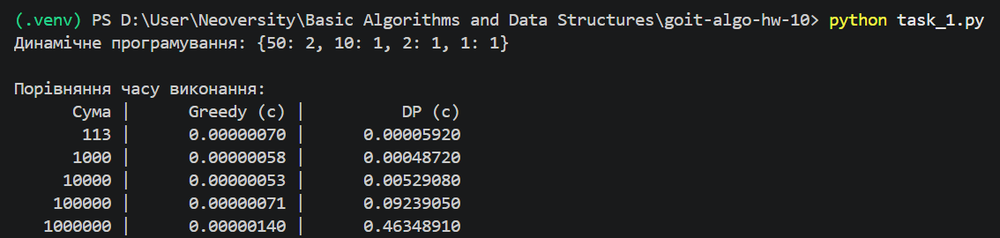
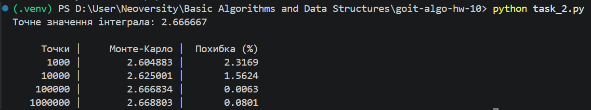

## Завдання 1. Видача решти

Реалізовано два алгоритми для набору монет [50, 25, 10, 5, 2, 1]:

- `find_coins_greedy` — жадібний алгоритм.
- `find_min_coins` — алгоритм динамічного програмування.

Для суми 113 обидва алгоритми використовують 5 монет:
50 + 50 + 10 + 2 + 1 = 113.

### Порівняння ефективності

| Алгоритм | Часова складність | Просторова складність |
|---|---|---|
| Жадібний | O(k) | O(k) |
| Динамічне програмування | O(n * k) | O(n) |

Де:
- n — сума решти;
- k — кількість доступних номіналів.

### Висновок

Жадібний алгоритм працює швидше та використовує менше пам'яті, особливо для великих сум.

Для заданого набору монет він знаходить оптимальний результат, тому є кращим вибором.

Динамічне програмування повільніше, оскільки обчислює мінімальну кількість монет для всіх проміжних сум. Проте воно гарантує оптимальний результат і для наборів монет, де жадібний алгоритм може помилятися.

## Завдання 2. Метод Монте-Карло

Обчислено інтеграл функції f(x) = x² на відрізку [0, 2].

Використано метод Монте-Карло на основі середнього значення функції у випадкових точках.

### Точне значення

Інтеграл від 0 до 2:

(x³ / 3) | від 0 до 2 = 8 / 3 ≈ 2.666667

### Перевірка точності

Розрахунки проведено для 1000, 10000, 100000 та 1000000 випадкових точок.

Для кожного результату обчислюється відносна похибка порівняно з точним значенням.

### Висновок

Метод Монте-Карло дозволяє наближено обчислювати визначені інтеграли за допомогою випадкових точок.

Зі збільшенням кількості точок результат зазвичай стає точнішим, хоча похибка може коливатися через випадковість вибірки.

Для простих функцій аналітичне інтегрування точніше, проте метод Монте-Карло корисний для складних функцій і багатовимірних інтегралів.

